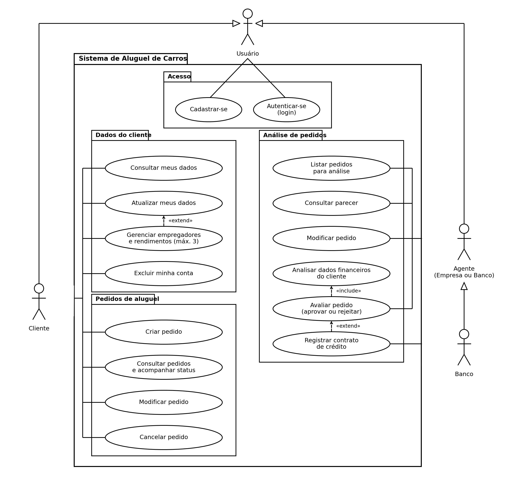
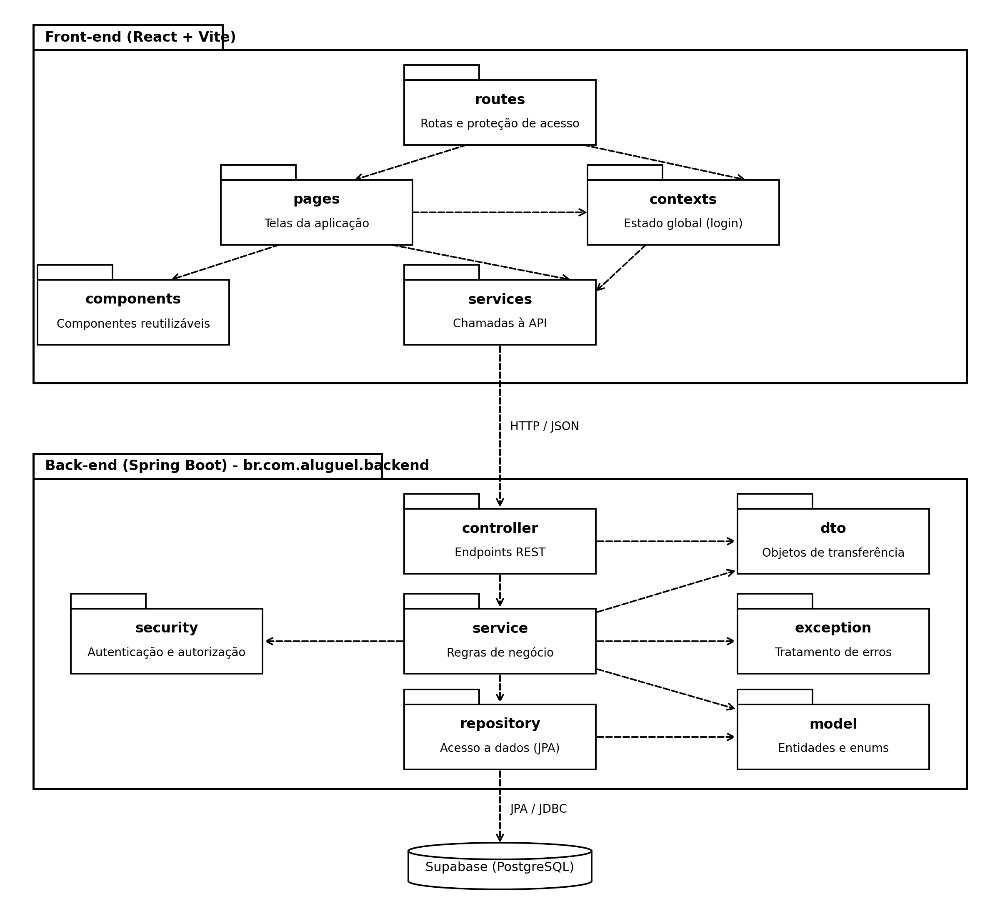
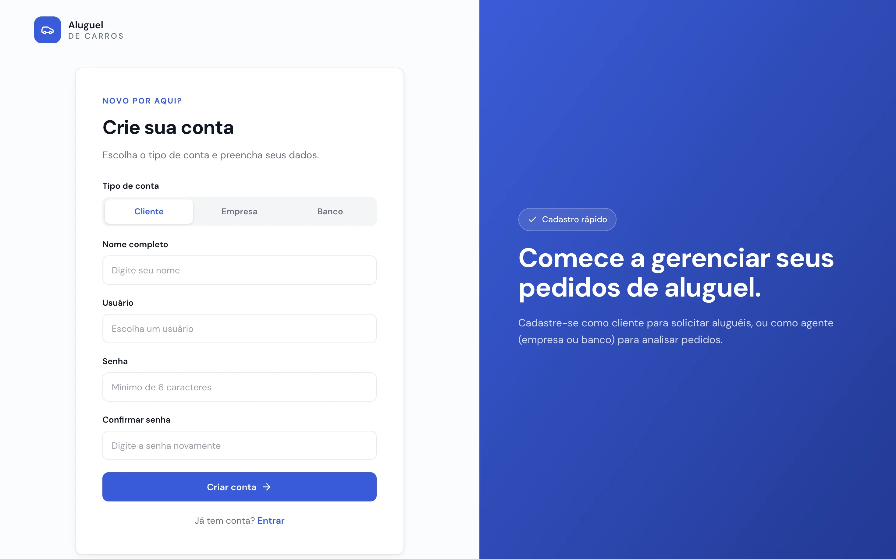
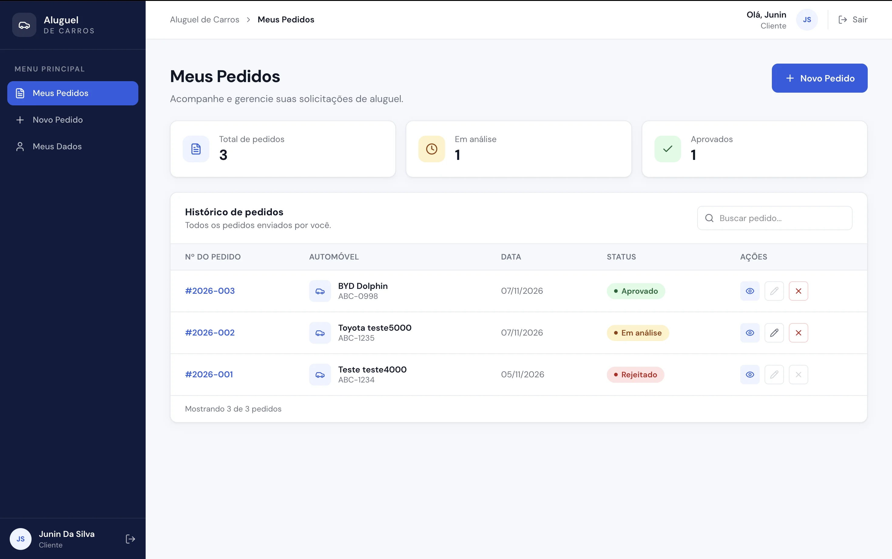
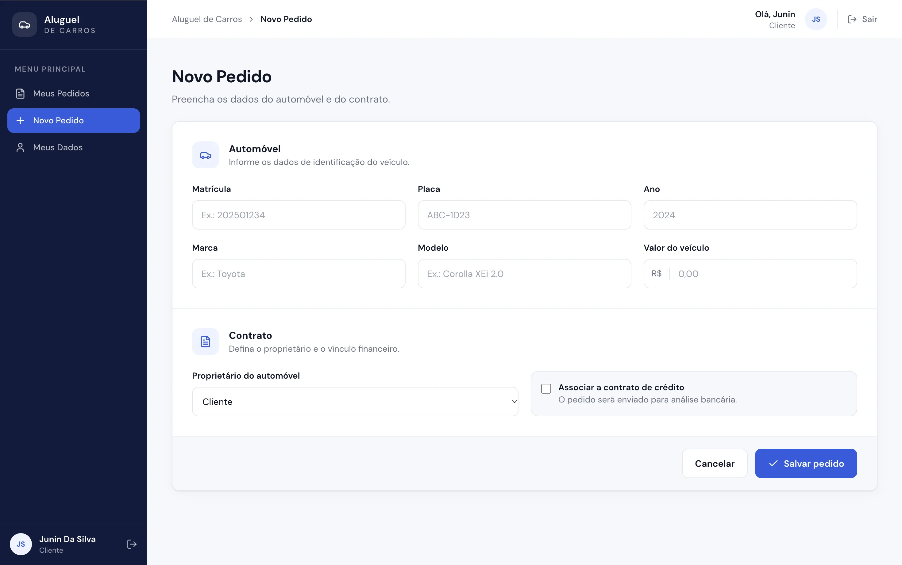
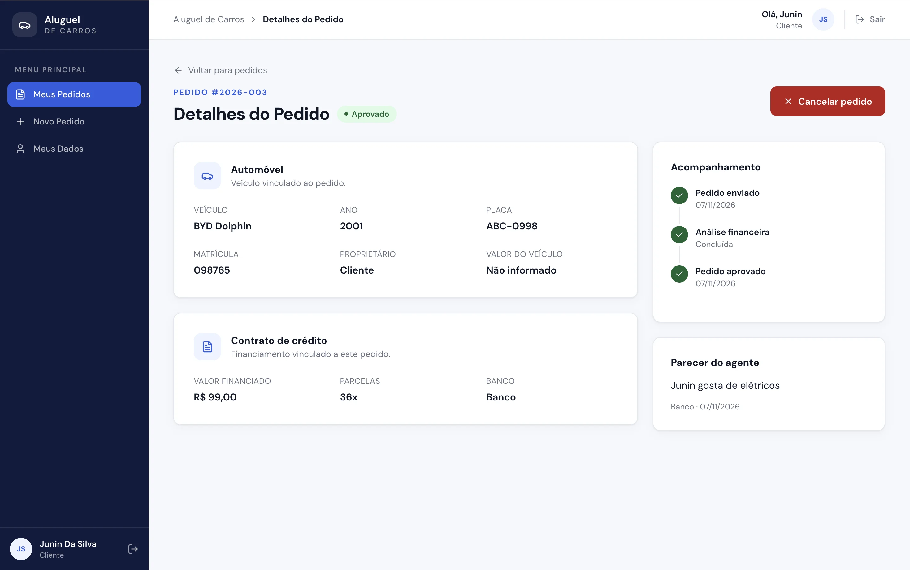
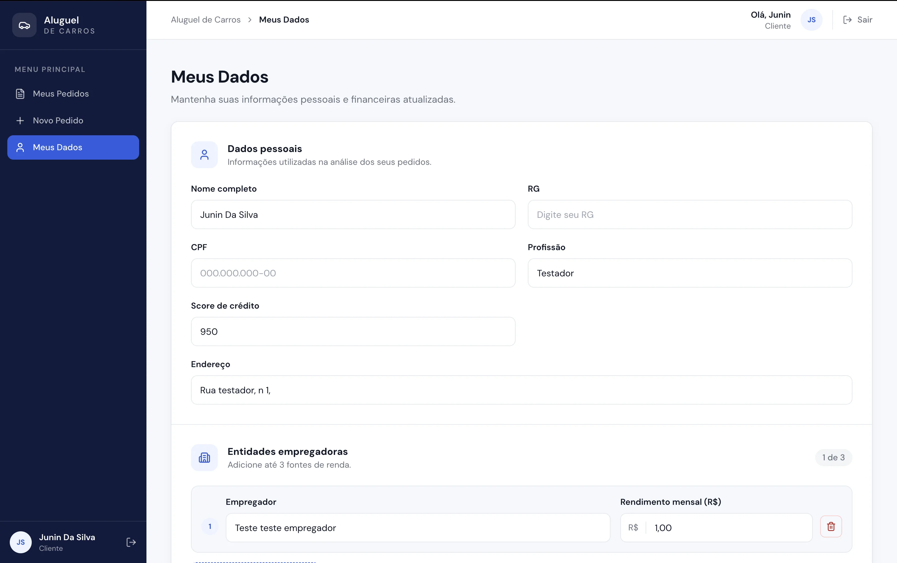
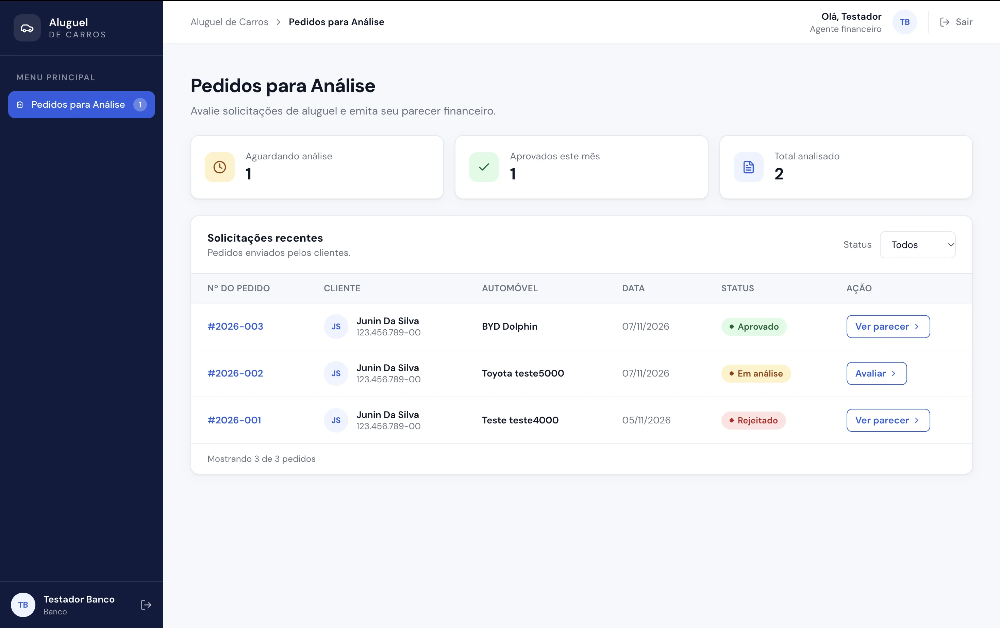
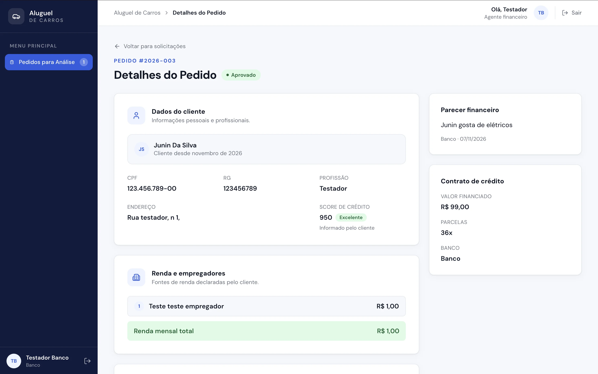

# 🚗 Sistema de Aluguel de Carros

> Sistema web para gestão de aluguéis de automóveis: clientes criam e acompanham pedidos, e agentes (empresas e bancos) analisam os pedidos e concedem crédito.

---

## 📚 Índice
- [Sobre o Projeto](#-sobre-o-projeto)
- [Funcionalidades Principais](#-funcionalidades-principais)
- [Regras de Negócio](#-regras-de-negócio)
- [Tecnologias Utilizadas](#-tecnologias-utilizadas)
- [Arquitetura](#-arquitetura)
- [API REST](#-api-rest)
- [Instalação e Execução](#-instalação-e-execução)
- [Usuários de teste](#-usuários-de-teste)
- [Estrutura de Pastas](#-estrutura-de-pastas)
- [Demonstração](#-demonstração)
- [Documentações utilizadas](#-documentações-utilizadas)
- [Autores](#-autores)

---

## 📝 Sobre o Projeto

Projeto do Laboratório 02 da disciplina de Desenvolvimento e Integração de Aplicações Web (Engenharia de Software, PUC Minas).

O sistema só pode ser usado após cadastro e login. **Clientes** cadastram seus dados pessoais e financeiros e criam, modificam, consultam e cancelam pedidos de aluguel. **Agentes** (empresas e bancos) analisam os pedidos do ponto de vista financeiro e registram um parecer. Quando o pedido está associado a um contrato de crédito, apenas um **banco** pode aprová-lo, definindo o valor financiado e as parcelas.

---

## ✨ Funcionalidades Principais

### 🔐 Autenticação
- Cadastro de conta como **Cliente**, **Empresa** ou **Banco**.
- Login com usuário e senha, com sessão por token (JWT).
- Rotas protegidas por perfil: cada tipo de usuário só acessa as suas telas.

### 👤 Cliente
- **Meus Dados (CRUD de cliente):** nome, RG, CPF, endereço, profissão, score de crédito e até 3 empregadores com seus rendimentos. É possível consultar, atualizar e excluir a própria conta.
- **Pedidos:** criar, listar (com resumo e busca), editar, cancelar e ver os detalhes.
- **Acompanhamento:** linha do tempo do status, parecer do agente e contrato de crédito.

### 🏦 Agente (empresa ou banco)
- **Pedidos para Análise:** lista com filtro por status e contador de pedidos aguardando análise.
- **Avaliação:** dados do cliente (com score e renda total), automóvel e valor do veículo, parecer obrigatório e decisão de aprovar ou rejeitar.
- **Banco:** pode aprovar pedidos com crédito, informando valor financiado e número de parcelas.

---

## 📋 Regras de Negócio

- O cliente pode ter no máximo **3 empregadores**, e o **CPF** não pode se repetir.
- O **score de crédito** vai de 0 a 1000 e é informado pelo cliente. O agente o vê com uma faixa: Baixo (até 500), Regular (501 a 700), Bom (701 a 850) e Excelente (acima de 850).
- Para criar um pedido, o cliente precisa ter os dados completos (RG, CPF, endereço, profissão, score e ao menos um empregador).
- O automóvel registra matrícula, ano, marca, modelo, placa, valor e proprietário (Cliente, Empresa ou Banco).
- O pedido nasce **Em análise** e só pode ser **editado** nesse status. Pode ser **cancelado** enquanto estiver em análise ou aprovado.
- O pedido recebe um número no formato `AAAA-NNN` (por exemplo, `2026-001`).
- O **parecer** do agente é obrigatório e a **decisão é definitiva**: só pedidos em análise podem ser avaliados.
- Pedidos **com contrato de crédito** só podem ser **aprovados por um banco**. Uma empresa pode apenas rejeitá-los.
- O **valor financiado** pelo banco não é limitado ao valor do veículo.
- Um cliente só enxerga os **próprios** pedidos, e a exclusão da conta é bloqueada se existirem pedidos vinculados.
- Senhas são guardadas com BCrypt, e o token de acesso expira em 2 horas.

---

## 🛠 Tecnologias Utilizadas

### 💻 Front-end
- React + Vite
- React Router
- Tailwind CSS
- Lucide React (ícones)

### ⚙️ Back-end
- Java 25
- Spring Boot 4.1.2 (arquitetura MVC)
- Spring Web, Spring Data JPA (Hibernate) e Bean Validation
- Spring Security com JWT (OAuth2 Resource Server)
- Apache Maven

### 🗄️ Banco de Dados
- Supabase (PostgreSQL)

---

## 🏛 Arquitetura

O sistema segue a arquitetura **MVC**: o **Model** são as entidades e os repositórios, o **Controller** são os controllers REST e os services (regras de negócio), e a **View** é a interface em React, que consome a API em JSON.

Os modelos UML ficam em [`docs/diagramas`](./docs/diagramas).

### Diagrama de Casos de Uso

O diagrama de casos de uso mostra o que cada tipo de usuário (Cliente, Agente e Banco) pode fazer no sistema. Ele serviu de base para definir as telas e as funcionalidades do protótipo.



### Diagrama de Classes

O diagrama de classes representa as entidades do sistema, seus atributos e como elas se relacionam. Ele orienta a criação das entidades do back-end e das tabelas no banco de dados.


### Diagrama de Pacotes

O diagrama de pacotes mostra como o código está organizado em camadas (MVC no back-end e páginas, componentes e serviços no front-end). Ele deixa claro quem depende de quem.



---

## 🔌 API REST

| Método | Rota | Perfil | Descrição |
|---|---|---|---|
| POST | `/api/auth/cadastro` | Público | Cria uma conta e devolve o token |
| POST | `/api/auth/login` | Público | Autentica e devolve o token |
| GET | `/api/clientes/me` | Cliente | Consulta os próprios dados |
| PUT | `/api/clientes/me` | Cliente | Atualiza os dados e os empregadores |
| DELETE | `/api/clientes/me` | Cliente | Exclui a própria conta |
| GET | `/api/pedidos` | Cliente | Lista os próprios pedidos |
| GET | `/api/pedidos/{id}` | Cliente | Detalha um pedido |
| POST | `/api/pedidos` | Cliente | Cria um pedido |
| PUT | `/api/pedidos/{id}` | Cliente | Edita um pedido em análise |
| POST | `/api/pedidos/{id}/cancelar` | Cliente | Cancela um pedido |
| GET | `/api/analise/pedidos` | Agente | Lista os pedidos para análise |
| GET | `/api/analise/pedidos/{id}` | Agente | Detalha um pedido para avaliação |
| POST | `/api/analise/pedidos/{id}/avaliacao` | Agente | Aprova ou rejeita um pedido |

Todas as rotas, exceto as de `/api/auth`, exigem o cabeçalho `Authorization: Bearer <token>`.

---

## 🚀 Instalação e Execução

### Pré-requisitos
- JDK 25
- Node.js (versão LTS)
- Um projeto no [Supabase](https://supabase.com)

### 1. Clonar o repositório

```bash
git clone https://github.com/Nicolas-De-Almeida/sistema-de-aluguel-de-carros.git
cd sistema-de-aluguel-de-carros
```

### 2. Banco de dados (Supabase)

1. Crie um projeto no Supabase e guarde a senha do banco.
2. Ao criar, desmarque **Enable Data API**: a API do sistema é o Spring Boot, e o acesso ao banco é feito direto por ele.
3. Em **Connect**, escolha **Session pooler** e copie o host, a porta e o usuário.

As tabelas são criadas automaticamente pelo Hibernate na primeira execução.

### 3. Back-end

Na pasta `backend/src/main/resources`, copie o arquivo de exemplo:

```bash
cp application-local.properties.example application-local.properties
```

Preencha o `application-local.properties` (esse arquivo não vai para o GitHub):

```properties
spring.datasource.url=jdbc:postgresql://HOST:5432/postgres?sslmode=require
spring.datasource.username=postgres.CODIGO_DO_PROJETO
spring.datasource.password=SENHA_DO_BANCO
app.jwt.secret=TEXTO_ALEATORIO_COM_PELO_MENOS_32_CARACTERES
```

Para gerar o segredo do JWT: `openssl rand -base64 48`.

### 4. Front-end

Na pasta `frontend`, crie o arquivo de ambiente a partir do exemplo:

```bash
cp .env.example .env
```

Ele contém o endereço da API:

```
VITE_API_URL=http://localhost:8080
```

### 5. Executar

**Terminal 1: back-end** (porta 8080)

```bash
cd backend
./mvnw spring-boot:run
```

**Terminal 2: front-end** (porta 5173)

```bash
cd frontend
npm install
npm run dev
```

Acesse **http://localhost:5173**.

---

## 🔑 Usuários de teste

| Perfil | Usuário | Senha |
|---|---|---|
| Cliente | lucas | 123456 |
| Agente (Banco) | ana | 123456 |

Essas contas já existem no banco do projeto, para facilitar os testes. Em um banco novo, crie as contas pela tela de cadastro.

---

## 📁 Estrutura de Pastas

```
sistema-de-aluguel-de-carros/
├── backend/                      # API REST em Spring Boot
│   ├── pom.xml
│   └── src/main/
│       ├── java/br/com/aluguel/backend/
│       │   ├── controller/       # Endpoints REST
│       │   ├── service/          # Regras de negócio
│       │   ├── repository/       # Acesso a dados (JPA)
│       │   ├── model/            # Entidades e enums
│       │   ├── dto/              # Objetos de transferência
│       │   └── security/         # Autenticação (JWT) e CORS
│       └── resources/
│           ├── application.properties
│           └── application-local.properties.example
├── frontend/                     # Interface em React + Vite
│   ├── package.json
│   └── src/
│       ├── pages/                # Telas (auth, cliente e agente)
│       ├── components/           # Componentes reutilizáveis
│       ├── contexts/             # Estado global (login)
│       ├── hooks/                # Hooks personalizados
│       ├── routes/               # Rotas e proteção de acesso
│       ├── services/             # Chamadas à API
│       └── utils/                # Formatadores e rótulos
├── docs/
│   ├── diagramas/                # Modelos UML
│   └── historias-de-usuario.md
└── README.md
```

---

## 🎬 Demonstração

### Login e cadastro

| Login | Cadastro |
|---|---|
|  |  |

### Cliente

| Meus Pedidos | Novo Pedido |
|---|---|
|  |  |

| Detalhes do Pedido | Meus Dados |
|---|---|
|  |  |

### Agente

| Pedidos para Análise | Avaliar Pedido |
|---|---|
|  |  |

---

## 🔗 Documentações utilizadas

- [React](https://react.dev/reference/react)
- [Vite](https://vite.dev/guide/)
- [React Router](https://reactrouter.com)
- [Tailwind CSS](https://tailwindcss.com/docs)
- [Spring Boot](https://docs.spring.io/spring-boot/index.html)
- [Spring Security](https://docs.spring.io/spring-security/reference/index.html)
- [Supabase](https://supabase.com/docs)

---

## 👥 Autores

- Nicolas de Almeida - [GitHub](https://github.com/Nicolas-De-Almeida)