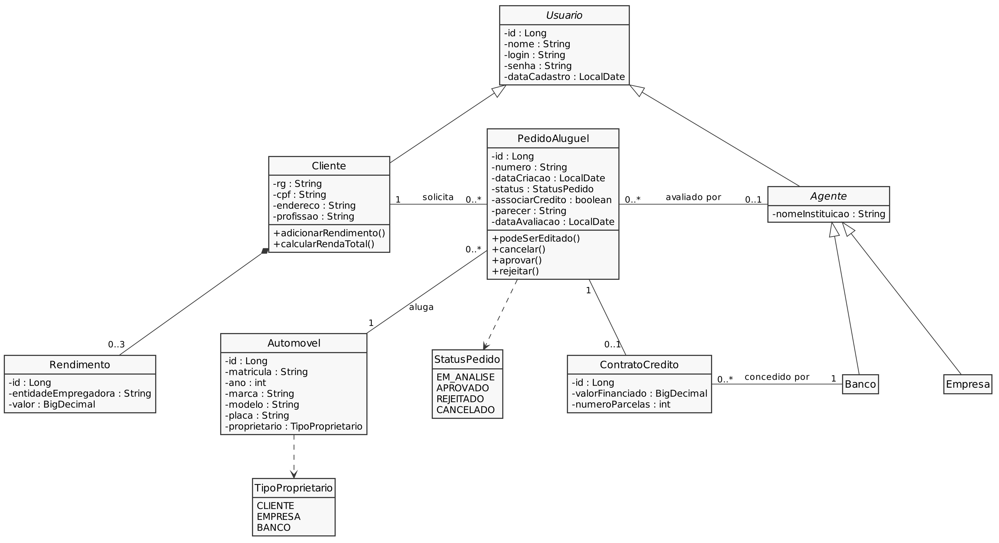
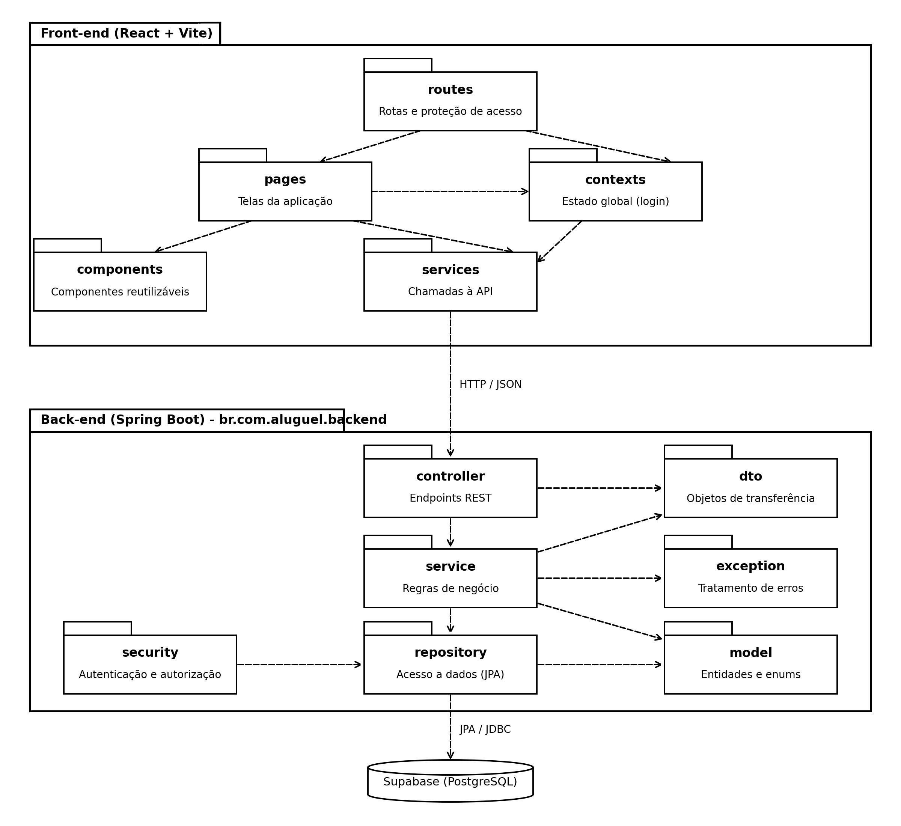

# 🚗 Sistema de Aluguel de Carros

> Sistema web para gestão de aluguéis de automóveis, permitindo efetuar,

---

## 📝 Sobre o Projeto

Projeto do Laboratório 02 da disciplina de Desenvolvimento e Integração de
Aplicações Web (Engenharia de Software, PUC Minas).

O sistema apoia a gestão de aluguéis de automóveis. Clientes (usuários
individuais) criam, modificam, consultam e cancelam pedidos de aluguel. Agentes
(empresas e bancos) avaliam financeiramente os pedidos e, em caso de parecer
positivo, seguem com a execução do contrato.

---

## ✨ Funcionalidades Principais

- 🔐 **Autenticação:** cadastro e login obrigatórios (usuário e senha).
- 👤 **CRUD de Clientes:** dados de identificação, profissão e até 3 entidades
  empregadoras com seus rendimentos.
- 📄 **Pedidos de Aluguel:** criação, modificação, consulta e cancelamento, com
  acompanhamento do status.
- 🏦 **Análise de Pedidos:** avaliação financeira pelos agentes.

---

## 🛠 Tecnologias Utilizadas

### 💻 Front-end
- React
- Vite

### ⚙️ Back-end
- Java 25
- Spring Boot 4.0.x (arquitetura MVC)
- Apache Maven

### 🗄️ Banco de Dados
- Supabase (PostgreSQL)

---

## 🏛 Arquitetura

#### *Diagrama de Casos de Uso*
O diagrama de casos de uso mostra o que cada tipo de usuário (Cliente, Agente e Banco) pode fazer no sistema. Ele serve de base para definir as telas e as funcionalidades.


#### *Diagrama de Classes:*
O diagrama de classes representa as entidades do sistema, seus atributos e como elas se relacionam. Ele orienta a criação das entidades do back-end e das tabelas no banco de dados.



#### *Diagrama de Pacotes:*
O diagrama de pacotes mostra como o código está organizado em camadas (MVC no back-end e páginas, componentes e serviços no front-end). Ele deixa claro quem depende de quem.



#### *Histórias de Usuário*
---

## 🚀 Instalação e Execução

### Pré-requisitos
- JDK 25
- Node.js (versão LTS)
- Conta e projeto criados no Supabase

### Variáveis de Ambiente

**Back-end:** credenciais do banco (Supabase)

```
DB_URL=
DB_USER=
DB_PASSWORD=
```

**Front-end:** endereço da API

```
VITE_API_URL=http://localhost:8080
```

### Como Executar

**Terminal 1: Back-end**

```bash
cd backend
./mvnw spring-boot:run
```

**Terminal 2: Front-end**

```bash
cd frontend
npm install
npm run dev
```

---

## 📁 Estrutura de Pastas

```
aluguel-de-carros/
├── backend/          # API REST em Spring Boot
├── frontend/         # Interface em React + Vite
├── docs/
│   └── diagramas/    # Modelos UML
└── README.md
```

---

## 🎬 Demonstração

Em breve.

---

## 🔗 Documentações utilizadas

- [React](https://react.dev/reference/react)
- [Vite](https://vitejs.dev/config/)
- [Spring Boot](https://docs.spring.io/spring-boot/docs/current/reference/html/)
- [Supabase](https://supabase.com/docs)

---

## 👥 Autor

- Nicolas De Almeida